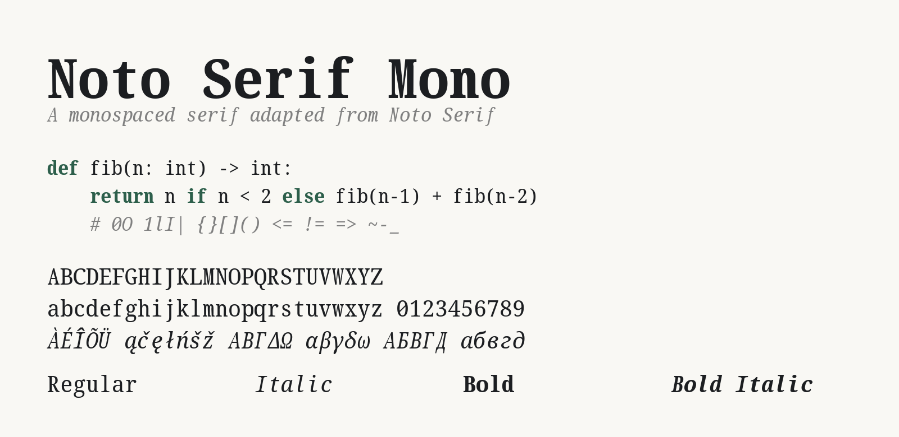

# Noto Serif Mono



Noto Serif Mono is a monospaced serif typeface for code, terminals and
technical writing. It adapts the outlines of
[Noto Serif](https://github.com/notofonts/latin-greek-cyrillic) to a
fixed 0.573 em cell. The adaptation condenses wide letters with
stroke-aware scaling, re-spaces the narrow letters, balances stroke
weight across the family, and adds TrueType hinting tuned for screens.

The family has four styles: Regular, Italic, Bold and Bold Italic. It
covers Latin, Greek and Cyrillic, with more than 2,800 encoded characters.

## Features

- Every glyph sits on one 573-unit advance, including accented, Greek and
  Cyrillic letters.
- Distinct `0O` and `1lI|`, plus a slashed zero through the `zero`
  feature.
- Small caps (`smcp`, `c2sc`), old-style and lining figures (`onum`,
  `lnum`), fractions, superscripts and subscripts, and localized forms
  for Catalan, Romanian, Moldovan, Serbian, Macedonian and others.
- Regular and Bold line up pixel for pixel at common screen sizes, so
  bold keywords sit on the same baseline and x-height as the code
  around them.

## Download

Font files are in [`fonts/ttf`](fonts/ttf). Tagged versions are
published on the [releases page](https://github.com/wmarklloyd/noto-serif-mono/releases).

## Building

Sources are UFO 3 files in [`sources/`](sources). The build uses
[gftools builder](https://github.com/googlefonts/gftools) with
fontmake, then ttfautohint with Noto Serif Mono's settings
([`scripts/hint.py`](scripts/hint.py)), with per-style control files
regenerated by [`scripts/make_hint_controls.py`](scripts/make_hint_controls.py).
`make test` needs [fontspector](https://github.com/fonttools/fontspector)
(`cargo install --locked fontspector`).

```sh
make build     # fonts/ttf and fonts/webfonts from sources
make verify    # check the build against the sources
make test      # fontspector, googlefonts profile, into out/fontspector
make proof     # HTML proofs into out/proof
```

GitHub Actions runs the same steps on every push. Tagging `v2.501`, for
example, also creates a release with the built fonts.

### Repository layout

| Path | Contents |
| --- | --- |
| `sources/` | UFO sources (one per style) and `config.yaml` for gftools builder |
| `fonts/ttf/` | Release binaries |
| `scripts/hint.py` | ttfautohint settings and the post-hinting family alignment |
| `scripts/make_hint_controls.py`, `sources/hinting/` | ttfautohint control files (accent clearance, undistorted glyphs); regenerate when outlines change |
| `scripts/ttf2ufo.py`, `scripts/verify_sources.py` | How the sources were made from the 2.501 binaries, and the round-trip check |
| `scripts/qa/` | FreeType render harness: hinting alignment, pedantic bytecode checks, clipping, stroke measurements |
| `scripts/history/` | The scripted Noto Serif → Noto Serif Mono pipeline, versions 1.2 to 2.5.1 (historical; reads system Noto fonts) |
| `documentation/` | Specimen, design notes, revision history and proofs |

## Status and roadmap

Noto Serif Mono is being prepared for submission to Google Fonts. See
[ONBOARDING.md](ONBOARDING.md) for the checklist and open items. The
main open items are a variable `wght` version and the decision on Windows
descent metrics.

## License

Noto Serif Mono is licensed under the SIL Open Font License, Version 1.1
(see [OFL.txt](OFL.txt)), with no Reserved Font Name. It is a modified
version of Noto Serif, © Google LLC, which is also licensed under the
OFL. Noto is a trademark of Google LLC. Noto Serif Mono is not affiliated with
or endorsed by the Noto project.

## Credits

- Noto Serif design: Monotype Design Team, for Google.
- Noto Serif Mono adaptation: Mark Lloyd.

See [AUTHORS.txt](AUTHORS.txt) and [CONTRIBUTORS.txt](CONTRIBUTORS.txt).
